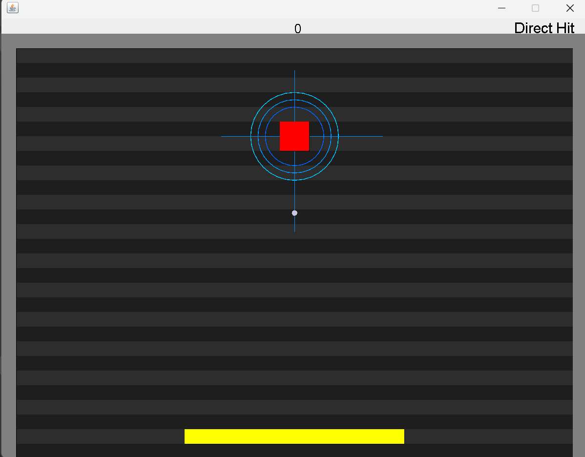
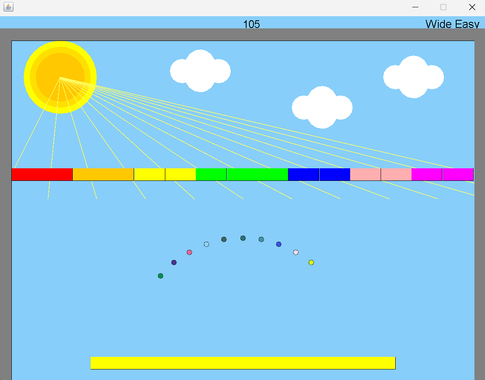
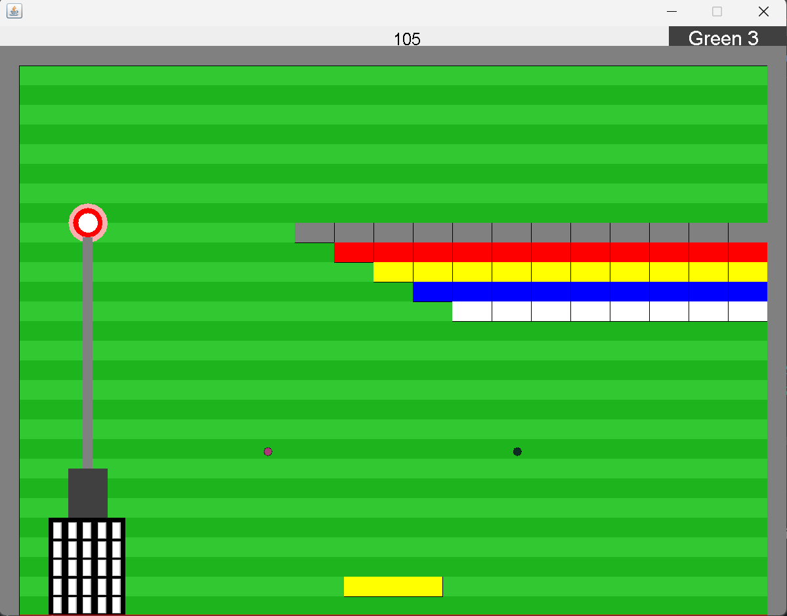

# Arkanoid Game🕹️

## Overview
A custom implementation of the classic **Arkanoid** game where the player controls a paddle to bounce a ball and break blocks. The game features multiple levels, each with unique designs and dynamic backgrounds.

## Features
- **Levels**: Each level has distinct backgrounds, block layouts, and challenges.
- **Backgrounds**: Custom backgrounds for each level.
- **Paddle**: Adjustable paddle speed and width.
- **Ball**: Configurable ball velocities.
- **Blocks**: Colorful and varied block designs.

## Controls
- **Move Paddle**: Left and right arrow keys.
- **Start**: Launch the game to begin.
- **Win**: Break all the blocks.
- **Lose**: Letting the ball fall below the paddle.

## Levels
### Direct Hit
- **1 Ball** with upward velocity.
- **Single Red Block** at the center.
- **Background**: Glowing circles and lines.
  



### Wide Easy
- **Multiple Balls**.
- **Wide Paddle** and colorful blocks.
- **Background**: Sky theme with sun and clouds.
  


### Green 3
- **Standard Paddle** and tower-shaped blocks.
- **Background**: Green-themed with geometric shapes.
  



## How to Run

**Prerequisites:** Java 8+ and [Apache Ant](https://ant.apache.org/). The graphics library (`biuoop-1.4.jar`) is included in the repo.

```bash
git clone https://github.com/elayben/Arknoid.git
cd Arknoid
ant run -Dargs="1 2 3"   # compile and play all three levels in order
ant run -Dargs="3 1"     # pick any levels, in any order
```

Levels: `1` Direct Hit · `2` Wide Easy · `3` Green 3

## Project Structure

```
src/
├── Ass6Game.java          # Entry point: parses level args, starts the game flow
├── Environment/           # Game loop, animations, collisions, listeners, score
├── GeometryPrimitives/    # Point, Line, Rectangle
├── Levels/                # Level definitions and their backgrounds
├── Movement/              # Velocity and collision info
└── Objects/               # Ball, Block, Paddle and other sprites
```

## Design

Built for the Object-Oriented Programming course at Bar-Ilan University, with an emphasis on clean OOP design: interfaces for `Sprite`, `Collidable` and `Animation`, the **Observer** pattern for hit events (`HitListener` / `HitNotifier`), and a pluggable `LevelInformation` interface so new levels need no changes to the engine. The code follows the course Checkstyle rules (`ant check`).
